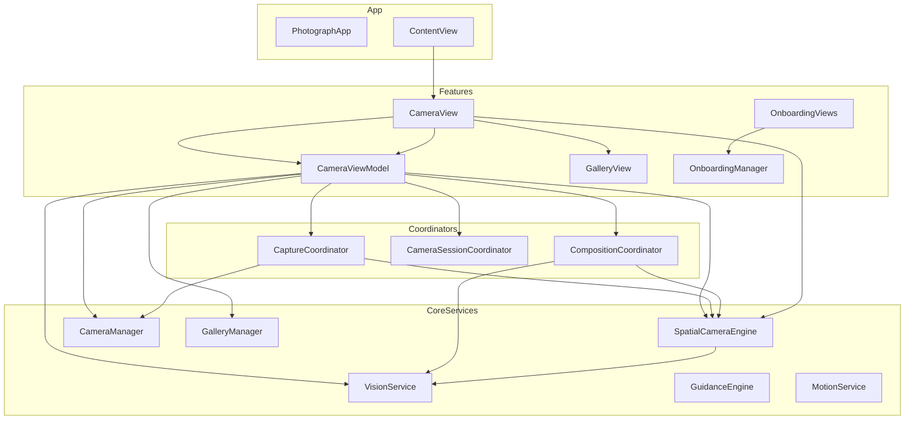

# Phase 0 — Architecture Audit

**Project:** C3Photograph (Photograph target)  
**Branch:** `refactor/ui-logic-app`  
**Date:** 2026-06-12  
**Scope:** 86 Swift files (~10,300 LOC), iOS 26 / Swift 6, ARKit + AVFoundation hybrid camera

---

## 1. Executive Summary

The codebase has already migrated from a flat `Models/`, `Services/`, `Views/` layout to a **feature-based tree** (`App/`, `Core/`, `Features/`, `Shared/`). That is the right direction, but the migration is **incomplete at the logic layer**:

| Area | Current state | Target (MVVM + clean boundaries) |
|------|---------------|----------------------------------|
| Folder layout | Feature folders exist | Presentation / Domain / Data split per feature |
| ViewModels | `CameraViewModel` is 637 LOC, god-object | Thin presentation VMs; domain in coordinators/use cases |
| Coordinators | 3 coordinators extracted | Own workflows; not mirrored in VM |
| Services | Large engines (`SpatialCameraEngine` 815 LOC) | Protocol-backed, decomposed subsystems |
| State | Dual stores (coordinator + VM copy) | Single source of truth per concern |
| Comments | Mix of verbose headers and stale notes | Apple-style `///` only where non-obvious |
| Onboarding | `ObservableObject` + `@EnvironmentObject` | `@Observable` + environment injection |

**Recommendation:** Incremental refactor on `refactor/ui-logic-app` — skeleton first, migrate feature-by-feature, build after each phase. Do **not** revert to flat structure or big-bang rewrite.

---

## 2. Current Architecture

### 2.1 Layer diagram (as implemented)

### 2.2 Feature inventory

| Feature | Views | ViewModels | Coordinators | Core deps |
|---------|-------|------------|--------------|-----------|
| **Camera** | `CameraView` (549), `SpatialCameraView`, `CameraPreviewView`, `CameraControlsView` + 15 components, 12 overlays | `CameraViewModel` (637) | Capture, Session, Composition | SpatialEngine, CameraManager, Vision, Motion, Guidance |
| **Gallery** | `GalleryView`, `PhotoDetailView` + 5 components | None (local `@State`) | None | GalleryManager, PrivacyPermission |
| **Onboarding** | Splash, Walkthrough, Tooltip, Congratulation | `OnboardingManager` (ObservableObject) | None | UserDefaults only |

### 2.3 Core subsystem map

| Subsystem | Primary files | Responsibility |
|-----------|---------------|----------------|
| **ARKit / Spatial** | `SpatialCameraEngine.swift` (815) | Session, tracking, subject lock, hi-res capture, zoom/flash/exposure |
| **AVFoundation** | `CameraManager.swift` (+Capture, +Delegates) | Front camera classic pipeline, B2 fallback capture |
| **Vision** | `VisionService.swift` (510), analyzers, `VisionRequestManager` | Frame analysis, ML composition, saliency, depth |
| **Guidance** | `GuidanceEngine.swift`, `GuidancePhase`, overlays | Phase machine + tip text + overlay visuals |
| **Capture orchestration** | `CaptureCoordinator`, `CameraSessionCoordinator` | Readiness, execute, session handoff |
| **Composition** | `CompositionCoordinator`, `CompositionAnalysis` | Pin subject, ML suggestion, user pick |
| **Gallery persistence** | `GalleryManager` (actor) | Save/load photos, metadata |
| **Permissions** | `PrivacyPermissionService` | Camera + photo library |
| **Design system** | `AppColors`, `Typography`, `Spacing`, `AppRadius` | Tokens; `GuidanceTipView` is camera-specific |

### 2.4 Dependency direction (actual)

- **App → Features:** `ContentView` → `CameraView` only (gallery via fullScreenCover from camera).
- **Camera → Core:** Heavy — VM constructs all services and coordinators in `init()`.
- **Camera → Gallery:** Presentation coupling (`CameraView` presents `GalleryView`).
- **Camera ↔ Onboarding:** Walkthrough embedded in `CameraView` / `PhotoDetailView`.
- **Gallery → Core:** `GalleryManager`, `CompositionType`, `StaticOverlayView` (duplicates grid logic).

**Violations:** Views observe engines directly; VM exposes `spatialEngine` and `cameraManager` publicly; composition state duplicated.

---

## 3. Target Architecture (summary — detail in PHASE1_BLUEPRINT.md)

| Principle | Implementation |
|-----------|----------------|
| **MVVM** | View ↔ ViewModel (presentation) ↔ Domain (coordinators/use cases) ↔ Data (services) |
| **Feature modules** | `Features/<Name>/Presentation|Domain|Data` |
| **Coupling** | Protocols in `Core/Protocols`; `AppDependencies` composition root |
| **State** | One owner per concern; VM exposes derived UI state only |
| **Coordinators** | Remain for multi-step workflows; renamed/clarified as Domain layer |
| **Services** | Split large engines; hide behind protocols |

---

## 4. Architectural Issues (by severity)

### CRITICAL — Correctness / threading

| ID | Location | Issue |
|----|----------|-------|
| C1 | `VisionService.swift:42-88, 268-281` | `currentAnalysis` mutated from MainActor and AR/background threads without consistent locking |
| C2 | `SpatialCameraEngine.swift:776-779, 672-675` | `consecutiveNormalFrames` written on AR delegate thread, read on `sessionQueue` |
| C3 | `SpatialCameraEngine.swift:799-803` | Vision work triggered synchronously from AR delegate callback |
| C4 | `CaptureCoordinator.swift:71-74` | Front capture: `resumeAfterCapture()` before photo delegate completes |

### MAJOR — Maintainability / boundaries

| ID | Location | Issue |
|----|----------|-------|
| M1 | `CameraViewModel.swift` (637 LOC) | God ViewModel: permissions, capture, composition, gallery, motion, dual camera routing |
| M2 | `CameraViewModel` + `CompositionCoordinator` | Duplicate `guidancePhase`, `mlSuggestion`, etc. + manual `syncCompositionState()` |
| M3 | `CameraView.swift` | Observes `spatialEngine` / `cameraManager` directly for save and tracking warnings |
| M4 | `CaptureCoordinator.isCaptureReady` | `guidancePhase` parameter ignored; gating split across VM and coordinator |
| M5 | `SpatialCameraEngine.swift` (815 LOC) | Session + capture + device controls + delegate in one type |
| M6 | `VisionService.swift` (510 LOC) | Spatial + classic dual pipelines with ~80% duplicated flow |
| M7 | `StaticOverlayView` vs `CompositionOverlayView` | Parallel grid drawing; drift risk |
| M8 | `OnboardingManager` | `ObservableObject` while rest of app uses `@Observable` |

### MINOR — Cleanup

| ID | Location | Issue |
|----|----------|-------|
| N1 | `PulsingTargetRing.swift` | Dead code — never referenced |
| N2 | `Features/Camera/Components/Elements/` | Empty directory |
| N3 | File headers | Verbose “Created by…” blocks on every file |
| N4 | `CODE_AUDIT.md` §9.1 | Recommends deleting `CameraManager` — outdated (front camera + B2 fallback need it) |
| N5 | `GuidanceTipView` in `Core/DesignSystem` | Camera-specific UI in shared design folder |

---

## 5. Code Smells

### 5.1 Oversized files

| File | Lines | Suggested split |
|------|------:|-----------------|
| `SpatialCameraEngine.swift` | 815 | SessionLifecycle, SubjectLock, SpatialCapture, DeviceControls |
| `CameraViewModel.swift` | 637 | CameraViewModel + PermissionViewModel + CompositionPresentation |
| `CameraView.swift` | 549 | Extract overlay stack, gesture layer, permission gate |
| `VisionService.swift` | 510 | SpatialVisionPipeline, ClassicVisionPipeline, AnalysisPublisher |
| `CompositionDirectionOverlay.swift` | 411 | Arrow + bracket subviews |

### 5.2 Duplication

- **Camera mode routing:** 7× `switch cameraMode` in `CameraViewModel` (lens, focus, zoom, flash, exposure).
- **Composition reset:** `resetGuidanceState` vs `clearPinnedSubject` in `CompositionCoordinator`.
- **Flash/zoom/exposure:** Parallel APIs on `SpatialCameraEngine` and `CameraManager`.
- **Guidance copy:** `GuidanceEngine` vs `CameraViewModel.guidanceTip` switch.
- **Grid rendering:** Live overlays vs `StaticOverlayView` for gallery.

### 5.3 State management

- `@Observable` + `@MainActor` on `CameraViewModel` — correct direction.
- Services use `@Observable` + `@unchecked Sendable` — opts out of concurrency checking.
- `GalleryManager` as `actor` — good pattern to extend.
- `OnboardingManager` as `ObservableObject` — inconsistent.

### 5.4 SwiftUI composition

- `CameraView` body is a deep `ZStack` with many conditional layers — hard for juniors to navigate.
- Good: components extracted (`CameraBottomBar`, `CaptureButton`, etc.).
- Missing: clear `// MARK:` sections for overlay vs chrome vs preview layers.

---

## 6. Xcode Project Structure

- **Build system:** `PBXFileSystemSynchronizedRootGroup` on `Photograph/` — all files under folder compile automatically.
- **Implication:** Legacy folders cannot coexist; archive code outside `Photograph/` or use exception sets.
- **ML model:** `FiveCompositionDetector.mlmodel` at target root.

---

## 7. Spec & Documentation Alignment

| Document | Status |
|----------|--------|
| `CODE_AUDIT.md` | Useful but partially stale (CameraManager, line refs) |
| `specs/active/capture-architecture/` | Documents B2 hybrid; ahead of refactor branch in places |
| `Docs/PRD.md` | Product context |
| Architecture docs | **Missing** until this audit |

---

## 8. Risk Register for Refactor

| Risk | Mitigation |
|------|------------|
| Breaking AR capture during service split | Protocol + adapter; keep old impl until tests pass |
| State drift when removing VM mirrors | Migrate one property group at a time; UI tests on shutter states |
| Build breaks from moved files | One feature per commit; `xcodebuild` after each |
| Junior dev confusion during dual structure | `MIGRATION.md` per feature with “old path → new path” |
| Concurrent editing on other branches | Work only on `refactor/ui-logic-app`; merge main periodically |

---

## 9. Phase 0 Exit Criteria

- [x] Feature and service inventory complete
- [x] Current vs target architecture documented
- [x] Issues classified by severity
- [x] Duplication and god-object hotspots identified
- [x] Refactor risks recorded
- [ ] **No production code modified** (this document only)

**Next:** [PHASE1_BLUEPRINT.md](./PHASE1_BLUEPRINT.md) — target MVVM structure, folder layout, migration phases.
