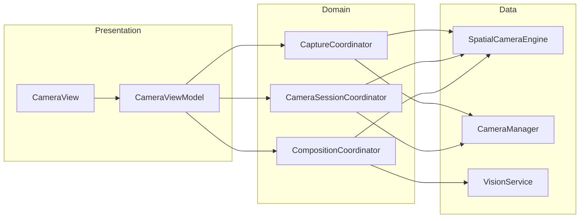
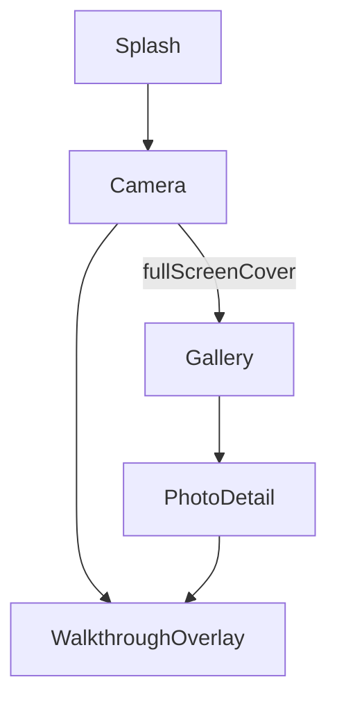

# Phase 1 — Architecture Blueprint

**Project:** C3Photograph  
**Branch:** `refactor/ui-logic-app`  
**Pattern:** MVVM + feature modules + coordinator-style domain workflows  
**Audience:** Junior iOS developers and reviewers

---

## 1. Design Goals

1. **Readable** — A new developer opens one feature folder and sees Presentation → Domain → Data.
2. **Testable** — Business rules live behind protocols; ViewModels are thin.
3. **Stable** — Old code keeps working until each slice is migrated and verified.
4. **Consistent** — `@Observable` + `@MainActor` for UI-bound types; `actor` for shared mutable services.

---

## 2. Target Folder Structure

```
Photograph/
├── App/
│   ├── PhotographApp.swift
│   ├── ContentView.swift
│   └── Dependencies/
│       └── AppDependencies.swift      # Composition root (singletons, factories)
│
├── Core/
│   ├── Protocols/                     # Service & repository interfaces
│   │   ├── Camera/
│   │   ├── Vision/
│   │   ├── Gallery/
│   │   └── Permissions/
│   ├── Models/                        # Shared value types (unchanged)
│   ├── DesignSystem/                  # Colors, typography, spacing only
│   ├── Utilities/                     # Pure helpers
│   └── Services/                      # Default implementations (migrate gradually)
│       ├── ARKit/
│       ├── AVFoundation/
│       ├── Vision/
│       └── Gallery/
│
├── Features/
│   ├── Camera/
│   │   ├── Presentation/
│   │   │   ├── Views/
│   │   │   ├── Components/
│   │   │   ├── Overlays/
│   │   │   └── ViewModels/
│   │   ├── Domain/
│   │   │   ├── Coordinators/          # Workflows (capture, session, composition)
│   │   │   └── UseCases/              # Optional thin commands (e.g. SavePhoto)
│   │   └── Data/
│   │       └── Adapters/              # Protocol conformances wrapping Core services
│   ├── Gallery/
│   │   ├── Presentation/
│   │   ├── Domain/
│   │   └── Data/
│   └── Onboarding/
│       ├── Presentation/
│       └── Domain/
│
└── Shared/
    ├── Components/                    # Cross-feature UI (grids, if shared)
    └── Extensions/
```

### Migration mapping (current → target)

| Current path | Target path | Phase |
|--------------|-------------|-------|
| `Features/Camera/Views/` | `Features/Camera/Presentation/Views/` | 3 |
| `Features/Camera/ViewModels/` | `Features/Camera/Presentation/ViewModels/` | 3 |
| `Features/Camera/Components/` | `Features/Camera/Presentation/Components/` | 4 |
| `Features/Camera/Overlays/` | `Features/Camera/Presentation/Overlays/` | 4 |
| `Features/Camera/Coordinators/` | `Features/Camera/Domain/Coordinators/` | 3 |
| `Core/Services/SpatialCameraEngine.swift` | `Core/Services/ARKit/` (+ protocols) | 5 |
| `Core/Services/CameraManager*.swift` | `Core/Services/AVFoundation/` | 5 |
| `Core/Services/Vision/` | `Core/Services/Vision/` (split pipelines) | 5 |
| `Core/DesignSystem/GuidanceTipView` | `Features/Camera/Presentation/Components/` | 4 |
| `Features/Gallery/*` | `Features/Gallery/Presentation/*` | 3 |

**Rule during migration:** Typealiases or thin re-export files stay at old paths until imports are updated in a dedicated commit.

---

## 3. MVVM Boundaries

### 3.1 Responsibility matrix

| Layer | Owns | Must not own |
|-------|------|--------------|
| **View** | Layout, animations, accessibility, user gestures | Business rules, direct service calls |
| **ViewModel** | UI state, formatted strings, enabling/disabling controls | ARKit session config, Vision request scheduling |
| **Domain** (Coordinators / Use cases) | Workflows, phase transitions, capture gating policy | SwiftUI types |
| **Data** (Services) | Hardware, frameworks, persistence | View-specific formatting |

### 3.2 Camera feature (target)



**ViewModel shrink target (~250 LOC):**

- Inject coordinators + **protocol-typed** services (not concrete engines).
- Expose `compositionState: CompositionUIState` (single struct) instead of 5 mirrored properties.
- Publish `CaptureUIState`, `PermissionUIState` as nested structs.
- Move `guidanceTip` assembly to `CompositionCoordinator` or `GuidancePresenter`.

### 3.3 Gallery feature (target)

- Add `GalleryViewModel` — today logic lives in views (`@State`, direct `GalleryManager` calls).
- `GalleryRepository` protocol wrapping `GalleryManager`.
- Keep `PhotoDetailView` thin; overlay uses **shared** `CompositionGridView` from `Shared/Components`.

### 3.4 Onboarding feature (target)

- Convert `OnboardingManager` → `@Observable @MainActor final class OnboardingStore`.
- Inject via `.environment(OnboardingStore.self)` (iOS 17+), drop `@EnvironmentObject`.
- Walkthrough positions: extract magic numbers to `WalkthroughLayout` enum.

---

## 4. Service Layer Boundaries

### 4.1 Protocol sketch

```swift
// Core/Protocols/Camera/SpatialCameraProviding.swift
@MainActor
protocol SpatialCameraProviding: AnyObject {
    var trackingState: ARCamera.TrackingState { get }
    var trackingStabilityProgress: Double { get }
    func startSession()
    func stopSession()
    func capturePhoto(aspectRatio: AspectRatioMode) async
    // ...
}

// Core/Protocols/Vision/VisionAnalyzing.swift
protocol VisionAnalyzing: Sendable {
    func processFrame(_ packet: SpatialFramePacket)
    var onAnalysisUpdated: (@Sendable (CompositionAnalysis) -> Void)? { get set }
}
```

Concrete types in `Core/Services/` conform initially; Camera feature uses protocols only in new code paths.

### 4.2 ARKit subsystem (decompose `SpatialCameraEngine`)

| Type | Responsibility |
|------|----------------|
| `ARSessionController` | `run` / `pause`, configuration, world map handoff |
| `ARSubjectLockService` | Raycast, anchor CRUD, lock quality |
| `ARCaptureService` | Hi-res frame capture, aspect crop |
| `ARCameraControls` | Zoom, flash, exposure on AR camera |
| `SpatialCameraEngine` (facade) | Composes above; implements `SpatialCameraProviding` |

### 4.3 Vision subsystem

| Type | Responsibility |
|------|----------------|
| `SpatialVisionPipeline` | `processSpatialFramePacket` |
| `ClassicVisionPipeline` | AV sample buffer path |
| `CompositionMLClassifier` | Core ML hysteresis |
| `VisionService` (facade) | Serializes analysis on one queue; implements `VisionAnalyzing` |

### 4.4 Capture pipeline (domain)

`CaptureCoordinator` remains the **single place** for:

- `isCaptureReady` (include `guidancePhase` + tracking stability)
- `executeCapture` (AR + B2 fallback if on branch)
- Single-flight / handoff flags

Remove duplicate gating from `CameraViewModel.shutterIsPerfect` where possible — VM **displays** readiness; coordinator **computes** it.

---

## 5. Dependency Ownership

### 5.1 `AppDependencies`

```swift
@MainActor
final class AppDependencies {
    static let shared = AppDependencies()

    let spatialCamera: SpatialCameraProviding
    let classicCamera: ClassicCameraProviding
    let vision: VisionAnalyzing
    let gallery: GalleryRepository
    let permissions: PermissionChecking

    private init() {
        // Wire concrete Core services once
    }

    func makeCameraViewModel() -> CameraViewModel { ... }
}
```

- **App** creates `AppDependencies.shared` once.
- **Views** use `@State private var viewModel = AppDependencies.shared.makeCameraViewModel()`.
- **Tests** inject mocks via initializer on `CameraViewModel`.

### 5.2 Lifetime rules

| Dependency | Owner | Lifetime |
|------------|-------|----------|
| Spatial / Classic camera | App / Camera feature | App session |
| VisionService | Camera feature | Tied to camera VM |
| GalleryManager | App singleton (`actor`) | App session |
| Coordinators | CameraViewModel | Per camera screen |

---

## 6. State Management Flow

### 6.1 Composition state (fix dual store)

**Today:** `CompositionCoordinator` + copied fields on VM.  
**Target:**

```swift
struct CompositionUIState: Equatable {
    var phase: GuidancePhase
    var mlSuggestion: CompositionType?
    var userPick: CompositionType?
    var isSubjectPinned: Bool
    var recommendedLabel: String?
}
```

- Coordinator holds authoritative `CompositionUIState`.
- VM observes coordinator via callback or `@Observable` coordinator exposed as `let composition: CompositionCoordinator` (already `@MainActor`).
- **Delete** `syncCompositionState()`.

### 6.2 Capture readiness

```swift
enum CaptureReadiness: Equatable {
    case scanning
    case compositionReady(CompositionType)
    case stabilizing(CompositionType)
    case captureReady(CompositionType)
    case capturing
}
```

Computed in `CaptureCoordinator` from `guidancePhase`, tracking, and handoff flags. VM exposes `var captureReadiness: CaptureReadiness`.

### 6.3 View → engine ban

`CameraView` must not observe `spatialEngine.capturedPhotoData`. VM handles:

```swift
func handleCapturedPhoto(_ data: Data) async
```

Registered in VM `init` on coordinator/service callbacks.

---

## 7. Navigation Flow



**Target:**

- `AppRouter` or `CameraRouter` enum: `.gallery`, `.photoDetail(PhotoItem)`.
- `CameraView` binds `router` state; onboarding overlay driven by `OnboardingStore.currentStep`.
- Decouple onboarding tooltip anchors from hard-coded CGRects where possible (use `AnchorPreferenceKey`).

---

## 8. Shared Components Strategy

| Component | Location | Used by |
|-----------|----------|---------|
| Grid lines, crosshair, subject box | `Shared/Components/CompositionGrid/` | Camera overlays, Gallery static overlay |
| Permission empty state | `Shared/Components/Permission/` | Camera, Gallery |
| Capture button chrome | Camera only | — |
| Design tokens | `Core/DesignSystem/` | All features |

Extract `CompositionGridView(composition:aspectRatio:)` first — highest duplication payoff.

---

## 9. Design System Structure

Keep **tokens only** in `Core/DesignSystem/`:

- `AppColors`, `Typography`, `Spacing`, `AppRadius`, `ReducedMotionModifier`

Move **feature UI** out:

- `GuidanceTipView` → `Features/Camera/Presentation/Components/`

Liquid Glass (iOS 26): apply only to camera chrome (toolbar, capture button) per `swiftui-liquid-glass` skill — gate with `#available(iOS 26, *)` and material fallback.

---

## 10. Camera Subsystem Structure (detailed)

```
Features/Camera/
├── Presentation/
│   ├── Views/
│   │   ├── CameraView.swift           # Orchestrates subviews only
│   │   ├── CameraPreviewLayer.swift   # Spatial + classic preview wrapper
│   │   └── CameraPermissionGate.swift
│   ├── ViewModels/
│   │   └── CameraViewModel.swift
│   └── Components/ + Overlays/
├── Domain/
│   ├── Coordinators/
│   │   ├── CaptureCoordinator.swift
│   │   ├── CameraSessionCoordinator.swift
│   │   └── CompositionCoordinator.swift
│   └── Models/
│       ├── CompositionUIState.swift
│       └── CaptureUIState.swift
└── Data/
    └── Adapters/
        ├── SpatialCameraAdapter.swift
        └── ClassicCameraAdapter.swift
```

---

## 11. Phase Plan (implementation order)

| Phase | Objective | Build risk | Rollback |
|-------|-----------|------------|----------|
| **0** | Audit (this doc) | None | N/A |
| **1** | Blueprint (this doc) | None | N/A |
| **2** | Skeleton: folders, protocols, `AppDependencies`, empty adapters | Low | Delete new folders |
| **3** | Migrate Gallery + Onboarding (smallest features) | Low | Revert feature commits |
| **4** | UI decomposition: `CameraView`, shared grids | Medium | Revert view commits |
| **5** | Domain: fix composition state, capture gating | Medium | Restore VM mirrors |
| **6** | Services: split Vision / Spatial engines | High | Keep facade delegating to monolith |
| **7** | Docs + comments + delete dead code | Low | N/A |

**Commit sequence (example):**

1. `audit: document current architecture`
2. `architecture: add MVVM blueprint and roadmap`
3. `architecture: add protocols and AppDependencies skeleton`
4. `gallery: introduce GalleryViewModel and repository`
5. `onboarding: migrate to Observable store`
6. `camera: move coordinators to Domain folder`
7. `camera: collapse composition state duplication`
8. `ui: extract CameraPreviewLayer and overlay stack`
9. `shared: add CompositionGridView`
10. `vision: extract SpatialVisionPipeline`
11. `arkit: split ARSessionController from SpatialCameraEngine`
12. `docs: align comments with Apple style`
13. `cleanup: remove PulsingTargetRing and empty dirs`

---

## 12. Documentation & Comment Rules (Phase 6 preview)

- Use `///` one-line summary on public types and non-obvious methods.
- Remove file header blocks (“Created by…”) progressively.
- No comments that restate the code (`// Set flash mode`).
- Keep comments for: ARKit lifetime rules, thread boundaries, B2 handoff sequence.

---

## 13. Validation Checklist (Phase 7)

- [ ] `xcodebuild -scheme Photograph` succeeds
- [ ] Rear spatial: pin → perfect → capture → gallery
- [ ] Front camera capture (if enabled on branch)
- [ ] Gallery → detail → back → camera resume
- [ ] Onboarding walkthrough completes
- [ ] No new Swift 6 concurrency warnings
- [ ] `CameraViewModel` < 300 LOC
- [ ] No view imports ARKit directly (except `SpatialCameraView` wrapper)

---

## 14. Why These Decisions

| Decision | Rationale |
|----------|-----------|
| MVVM not TCA | Team size and app scope; coordinators already approximate reducers |
| Keep coordinators | They match multi-step camera workflows; renaming to Domain clarifies role |
| Protocols before splits | Allows incremental service decomposition without breaking callers |
| Gallery first migration | No AR complexity; proves folder + VM pattern |
| Shared grid component | Removes highest duplication; visible consistency win |
| `@Observable` everywhere | Matches iOS 17+ and SwiftUI observation tracking |
| No big-bang | AR camera regressions are costly; incremental commits are reviewable |

---

**Status:** Blueprint complete. Proceed to **Phase 2 — Skeleton Creation** on `refactor/ui-logic-app`.
